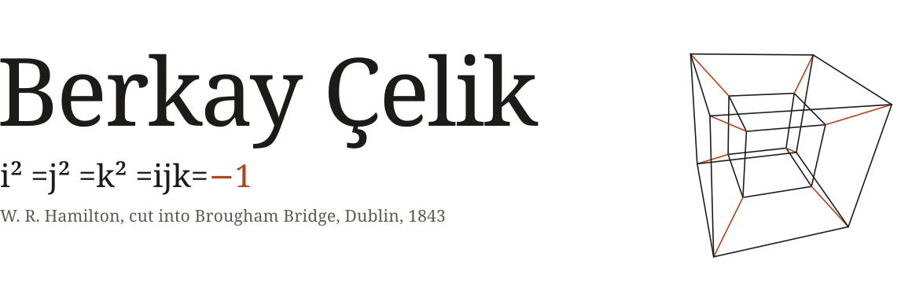

<picture>
  <source media="(prefers-color-scheme: dark)" srcset="assets/header-dark.svg">
  
</picture>

I'm a software engineer in Turkey. Right now I'm finishing a thesis that asks whether four-dimensional numbers can read a market better than ordinary ones. Most of my other time goes into tools for working alongside coding agents.
